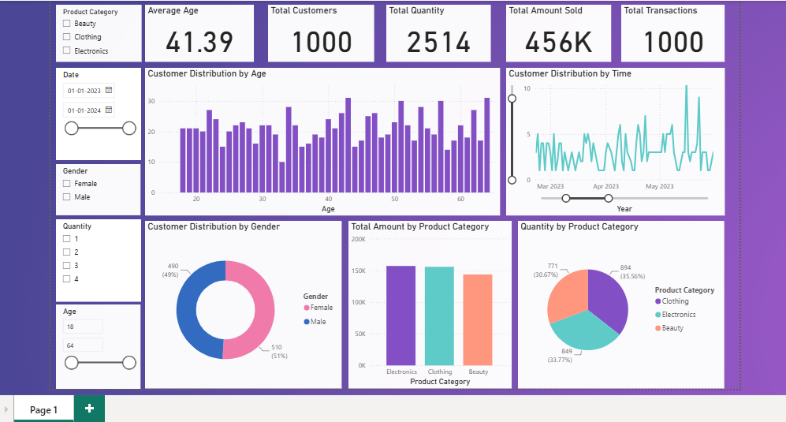

# Retail Sales & Customer Analysis Dashboard (Power BI)

An interactive Power BI dashboard that explores retail sales transactions and customer demographics. It answers questions such as: *Who are our customers? Which product categories drive revenue? How does customer activity change over time?*


<!-- Add a screenshot of your report to /images/dashboard.png -->

---

## Overview

The report is a single page built on one data table (`Feuil1`) and combines headline KPIs, demographic breakdowns, and sales-by-category views. Five slicers let the viewer filter the whole page by customer and product attributes.

## Dataset

Transactional retail data with one row per transaction.

| Column | Description |
|---|---|
| `Transaction ID` | Unique ID of each transaction |
| `Date` | Date of the transaction |
| `Customer ID` | Customer identifier |
| `Gender` | Customer gender |
| `Age` | Customer age |
| `Product Category` | Category of the purchased product |
| `Quantity` | Number of units purchased |
| `Total Amount` | Total value of the transaction |

> **Source:** _add dataset source / link here_
> **Period covered:** _add date range here_

## Dashboard Contents

### KPI Cards
- **Total Transactions** – count of transactions
- **Total Customers** – number of customers
- **Total Quantity** – total units sold
- **Total Amount Sold** – total revenue
- **Average Age** – age of the customer base

### Visuals
| Visual | Type | Insight |
|---|---|---|
| Customer Distribution by Age | Clustered column chart | Which age groups buy the most |
| Customer Distribution by Time | Line chart (Year > Quarter > Month > Day drill-down) | Customer activity trends and seasonality |
| Customer Distribution by Gender | Donut chart | Gender split of the customer base |
| Total Amount by Product Category | Column chart | Revenue contribution per category |
| Quantity by Product Category | Pie chart | Share of units sold per category |

### Slicers
Filter the full page by **Age**, **Date**, **Gender**, **Product Category**, and **Quantity**.

## Key Insights

_Fill these in after exploring the report, for example:_
- _Top-performing product category by revenue: …_
- _Age group with the most customers: …_
- _Peak month / quarter for customer activity: …_
- _Gender split: …_

## Tools & Techniques

- **Power BI Desktop** (data modeling and report design)
- Date hierarchy for time drill-down 
- Cross-filtering between visuals and slicers
- **Bloom** theme for styling

## How to Use

1. Clone or download this repository.
2. Open `powerbi_project.pbix` in [Power BI Desktop](https://powerbi.microsoft.com/desktop/) (free).
3. Use the slicers on the page to filter, and click any chart element to cross-filter the other visuals.

## Repository Structure

```
├── powerbi_project.pbix   # Power BI report
├── images/
│   └── dashboard.png      # Dashboard screenshot
└── README.md
```

## Author

**_ASWATHI BABURAJ_** · [linkedin.com/in/aswathi-baburaj-099a4737a?](#) · [Portfolio](#)
